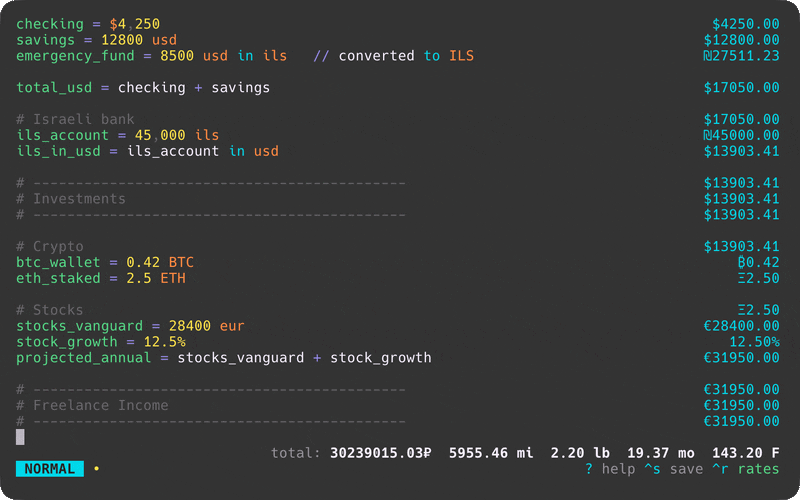

<p align="center">
  
</p>

<p align="center">
  <a href="https://github.com/nasedkinpv/numr/actions/workflows/ci.yml"></a>
</p>

A text calculator for natural language expressions with a vim-style TUI.

<p align="center">
  <strong><a href="https://numr.cc">Try it online →</a></strong>
</p>

<p align="center">
  
</p>

## Features

- Natural language expressions, variables, and continuations: `20% of 150`, `tax = 15%`, `+ 10`
- Unit and currency conversions, compound units, math functions, and number bases
- TUI with Vim or Standard editing, syntax highlighting, mouse scrolling, wrapping, and grouped totals
- Saved calculation documents, CLI/REPL, and a JSON-RPC backend for integrations

## Installation

Packages and [release archives](https://github.com/nasedkinpv/numr/releases/latest) include `numr` (TUI) and `numr-cli` (CLI/REPL/JSON-RPC server).

### macOS (Homebrew)

```bash
brew tap nasedkinpv/tap
brew install numr
```

### Arch Linux (AUR)

```bash
# Using yay
yay -S numr

# Using paru
paru -S numr
```

### From source

Requires Rust 1.88 or later. From the repository root:

```bash
# Install the TUI binary
cargo install --path crates/numr-tui

# Install the CLI binary
cargo install --path crates/numr-cli

# Or build both from source
cargo build --release

# Binaries will be available at target/release/numr and target/release/numr-cli
```

## Usage

### TUI Mode

```bash
# Open default.numr in the OS config directory (unless configured otherwise)
numr

# Open specific file
numr example.numr
```

### CLI Mode

```bash
# Single expression
numr-cli "20% of 150"

# Evaluate file (aligned "input = result" output)
numr-cli -f example.numr

# Interactive REPL
numr-cli -i

# Pipe mode
echo "100 + 200" | numr-cli

# Show running total
numr-cli -t -f example.numr

# Aligned output for any mode
numr-cli --verbose "20% of 150"
```

By default, `numr-cli` prints just the result. File mode (`-f`) uses aligned `input = result` output. Use `--verbose` to get aligned output in other modes. Use `-t` to show a running total at the end.

On Linux, use `rlwrap numr-cli -i` for readline-style history and editing in the REPL.

### JSON-RPC Server Mode

Run `numr-cli --server` for newline-delimited JSON-RPC 2.0 over stdin/stdout:

```bash
echo '{"jsonrpc":"2.0","method":"eval","params":{"expr":"20% of 150"},"id":1}' | numr-cli --server
# {"jsonrpc":"2.0","result":{"type":"number","value":"30","display":"30"},"id":1}
```

The server loads cached rates without fetching; use `reload_rates` for a network refresh. See the [JSON-RPC reference](docs/json-rpc.md) for methods, batches, notifications, schemas, and limits.

## Keybindings (TUI)

Start typing with `i` in **Vim** mode (default), or press `Shift+Tab` for **Standard** direct input. `Ctrl+S` saves; `F1` opens help in Normal or Standard mode. Quit with `q` in Vim Normal mode or `Ctrl+Q` in Standard mode. See the [full keybindings](docs/user-guide.md#keybindings-tui).

## Supported Operations

| Category | Examples |
|----------|----------|
| Arithmetic | `10 + 20`, `6 * 7`, `2 ^ 8` |
| Percentages | `20% of 150`, `$50 - 10%`, `100 + 15%` |
| Variables | `tax = 8%` then `100 + tax` |
| Continuation | `$100` → `+ $50` → `* 2` (chains from previous) |
| Functions | `sum()`, `avg()`, `min()`, `max()`, `median()`, `clamp()`, `sqrt()`, `abs()`, `round()`, `floor()`, `ceil()`, `sin()`, `cos()`, `tan()`, `rad()`, `deg()`, `ln()`, `log()`, `log_y()`, `factorial()`, `mod()` |
| Base conversion | `22 to hex` → `0x16`, `22 to bin` → `0b10110` |
| Unit conversion | `5 km in miles`, `22 C in F`, `1 TB in GB` |
| Compound units | `5 m * 10 m` → `50 m²`, `100 km / 2 h` → `50 km/h` |
| Angles | `sin(90°)`, `90° to rad`, `3.14159 rad to deg`, `rad(180)`, `deg(pi)` |
| Currency | `$100 in eur`, `1 BTC in USD` |
| Comments | `# comment` or `// comment` |
| Reference previous | `_` or `ANS` for last result |

`round(x, n)` rounds the value to 0–28 decimal places using midpoint-to-even rounding; `round(x)` rounds to an integer. Display precision remains a separate setting.

**Compound unit aliases**: `kph` (km/h), `mph` (mi/h), `mps` (m/s), `m2` (m²), `km2` (km²), `ft2` (ft²)

See [example.numr](example.numr) for a complete, executable tour of arithmetic, variables, continuations, functions, currencies, angles, and compound units. Constants are `pi`, `e`, and `phi`.

## Supported Units

| Category | Units |
|----------|-------|
| Length | `km`, `m`, `cm`, `mm`, `mi`/`miles`, `ft`/`feet`, `in`/`inches` |
| Area | `m²`/`m2`, `km²`/`km2`, `ft²`/`ft2`, `acre`, `hectare`/`ha` |
| Speed | `m/s`/`mps`, `km/h`/`kph`, `mph`, `knot` |
| Weight | `kg`, `g`, `mg`, `lb`/`lbs`, `oz`, `ton` |
| Volume | `L`, `mL`, `gal`, `m³`/`m3` |
| Time | `months`/`mo`, `weeks`/`wk`, `days`/`d`, `hours`/`hr`/`h`, `minutes`/`min`, `seconds`/`sec`/`s` |
| Energy | `J`, `kJ`, `cal`, `kcal`, `kWh` |
| Power | `W`, `kW` |
| Temperature | `K`/`Kelvin`, `C`/`Celsius`, `F`/`Fahrenheit` |
| Data | `TB`, `GB`, `MB`, `KB`, `bytes` |
| Fiat | `$`/`USD`, `€`/`EUR`, `£`/`GBP`, `¥`/`JPY`, `CHF`, `CNY`, `CAD`, `AUD`, `₹`/`INR`, `₩`/`KRW`, `₽`/`RUB`, `₪`/`ILS`, `zł`/`PLN`, `₴`/`UAH`, `₸`/`KZT` |
| Crypto | `₿`/`BTC`, `Ξ`/`ETH`, `◎`/`SOL`, `₮`/`USDT`, `USDC`, `BNB`, `XRP`, `₳`/`ADA`, `Ð`/`DOGE`, `DOT`, `Ł`/`LTC`, `LINK`, `AVAX`, `MATIC`, `TON` |

## Configuration

Native settings, `default.numr`, and the shared 1-hour rate cache live in the OS config directory. Set `[preferences] decimals` in `config.toml` for display-only precision; web settings are separate. See the [user guide](docs/user-guide.md#configuration) for paths, the full config example, precision semantics, and each frontend's cache/network policy.

## Architecture

`numr-core` owns calculation semantics; `numr-editor` provides shared highlighting and UTF-8 primitives. CLI, TUI, web, and desktop are I/O and presentation adapters. See [architecture](docs/architecture.md) for contracts and data flow. The web frontend lives in the separate [numr-web repository](https://github.com/nasedkinpv/numr-web).

## Integrations

- [elephant-numr](https://github.com/nasedkinpv/elephant-numr) — Provider for [Walker/Elephant](https://github.com/abenz1267/walker) launcher
- [omarchy-numr](https://github.com/nasedkinpv/omarchy-numr) — Omarchy Quattro calculator overlay using `numr-cli --server` and sharing the TUI's document.

## License

MIT
